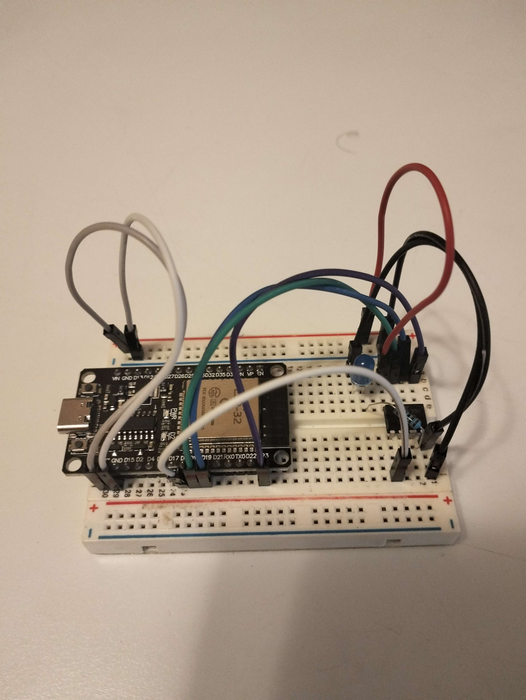
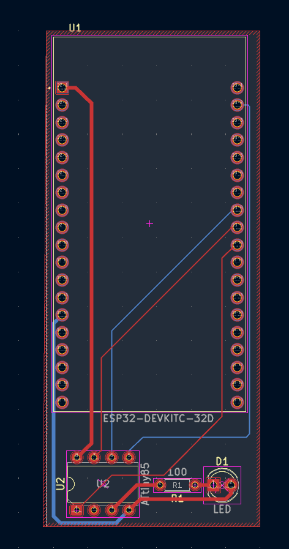
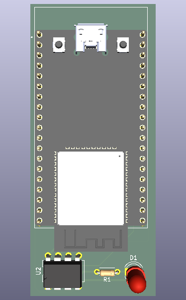
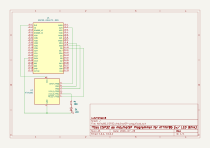

# ArduinoISP_program_attitny85_using_esp32

Projeto para utilizar um ESP32 como programador ArduinoISP para um microcontrolador ATTiny85.

## Montagem

## Esquemáticos e PCB KiCad

- [Esquema em PDF](kicad/Attiny85_ESP32_ArduinoISP-prog.pdf)
- [Ficheiro de esquema KiCad](kicad/Attiny85_ESP32_ArduinoISP-prog.kicad_sch)
- [Ficheiro de PCB KiCad](kicad/Attiny85_ESP32_ArduinoISP-prog.kicad_pcb)
- [Visualização 3D da PCB](kicad/Attiny85_ESP32_ArduinoISP-prog.step)

## O que este projeto faz

- Transforma um ESP32 num programador ISP (In-System Programmer) compatível com o protocolo ArduinoISP.
- Permite carregar firmware para um ATTiny85 utilizando a IDE Arduino ou PlatformIO.

## Pinagem (ESP32 para ATTiny85)

- **ESP32_SCK (GPIO 18)** -> **ATTiny85_SCK (Pin 2 / PB2)**
- **ESP32_MOSI (GPIO 23)** -> **ATTiny85_MOSI (Pin 5 / PB0)**
- **ESP32_MISO (GPIO 19)** -> **ATTiny85_MISO (Pin 6 / PB1)**
- **ESP32_RST (GPIO 5)** -> **ATTiny85_RST (Pin 1 / PB5)**
- **ESP32_GND** -> **ATTiny85_GND (Pin 4)**
- **ESP32_VCC (3.3V)** -> **ATTiny85_VCC (Pin 8)**

## Ficheiros principais

### Firmware do ESP32 (ArduinoISP)
- [main.cpp](ArduinoISP_program_attitny85_using_esp32_PlatformIO/src/main.cpp)
- [platformio.ini](ArduinoISP_program_attitny85_using_esp32_PlatformIO/platformio.ini)

### Exemplo de Firmware para ATTiny85 (LED Blink)
- [main.cpp](Attiny85_LEDblink_esp32_as_ISP_PlatformIO/src/main.cpp)
- [platformio.ini](Attiny85_LEDblink_esp32_as_ISP_PlatformIO/platformio.ini)
