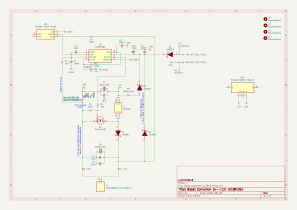
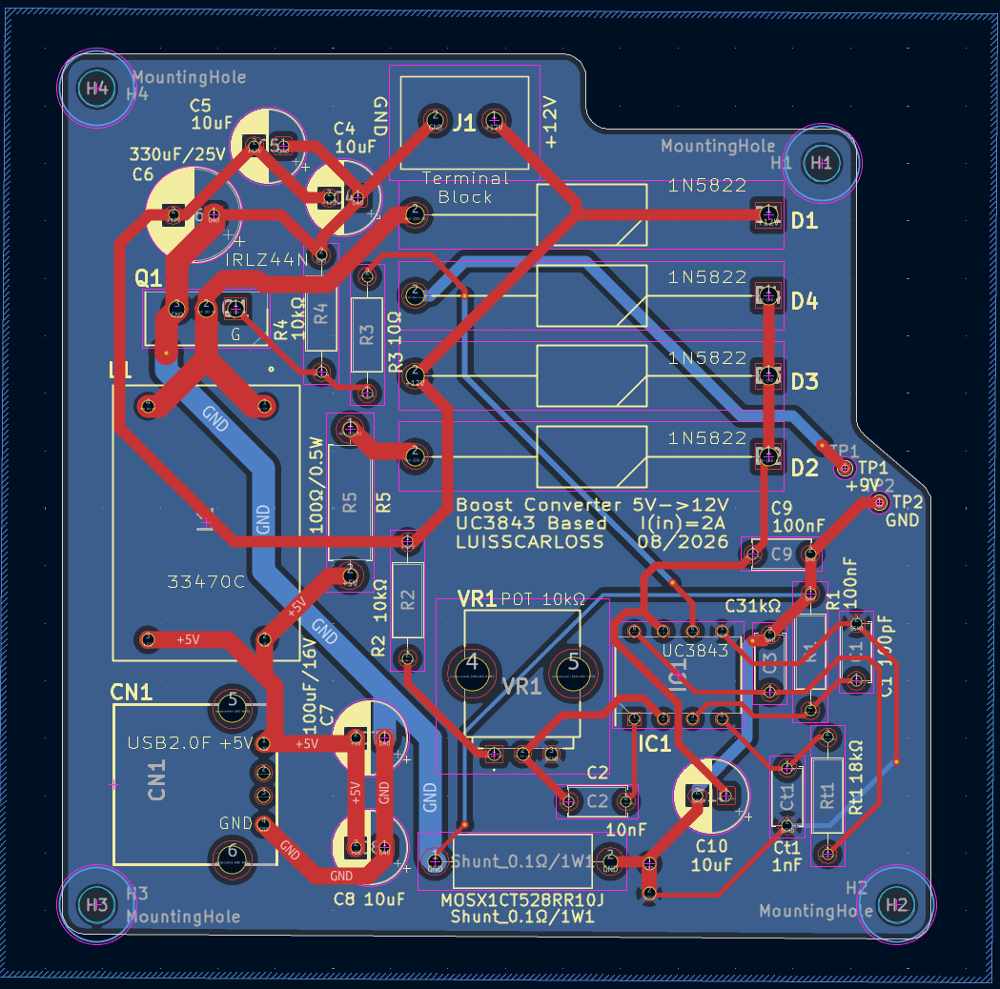
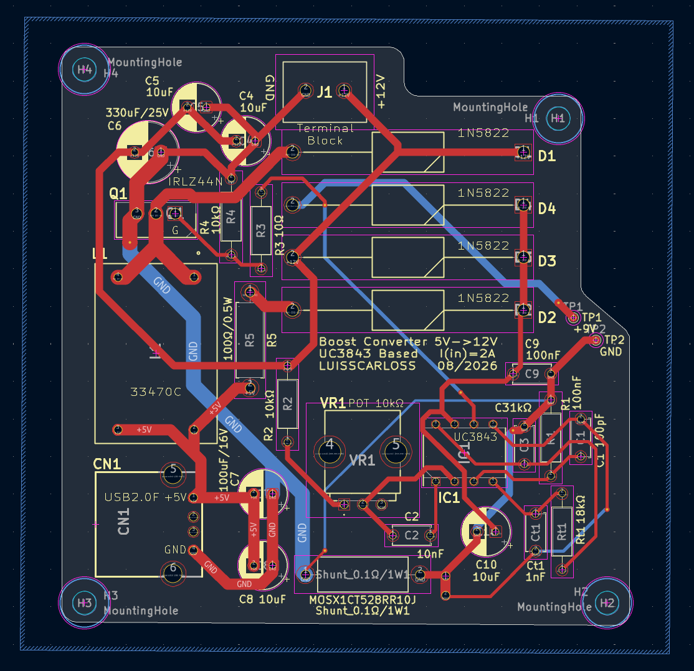
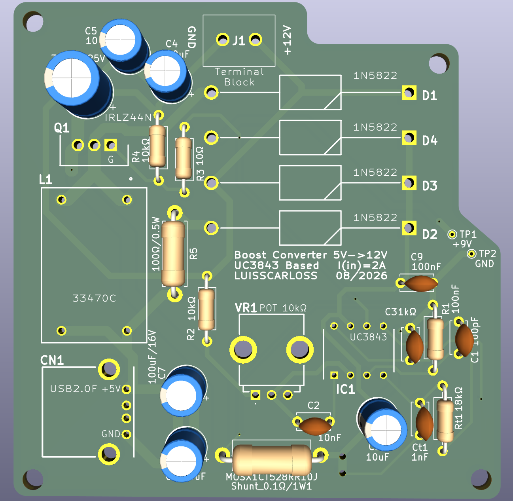

# ⚡ Conversor Boost (Step-Up) 5V para 12V com UC3843

Este projeto detalha a implementação de um conversor DC-DC Boost (Step-Up) que eleva uma tensão de entrada de 5V (ideal para ser alimentado via USB 2.0) para uma saída regulada de 12V. O circuito é baseado no popular controlador PWM UC3843, conhecido pela sua robustez e eficiência em aplicações de comutação.

## 📝 Resumo do Projeto

Fornecer uma fonte de alimentação de 12V estável a partir de uma fonte de 5V, útil para alimentar diversos módulos e componentes eletrónicos que requerem uma tensão mais elevada. O design tem de considerar as regras para um circuito de potência, como seleção de componentes, layout de PCB e dissipação térmica.

## 🎨 Design KiCad

### 💡 Esquema Elétrico

O esquema elétrico detalha a interconexão de todos os componentes, incluindo o controlador UC3843, MOSFET de potência, díodos Schottky, indutor e condensadores de filtro.



### 🗺️ Layout da PCB

A PCB foi desenhada para otimizar o desempenho do conversor, minimizando ruído e perdas. Abaixo, pode ver o layout com e sem o plano de terra (ground plane).

**Com Ground Plane:**


**Sem Ground Plane:**


### 📦 Vista 3D do Circuito

Uma renderização 3D da placa montada para visualização do aspeto final do circuito.



## 📊 Lista de Materiais (BOM)

A lista completa de componentes pode ser encontrada nos seguintes ficheiros:

* [KiCad BOM (CSV)](KiCad/boost_converter_uc3843.csv)
* [Farnell BOM (Excel)](KiCad/boost_converter_uc3843.xls)

## 🔎 Componentes Chave

Alguns dos componentes mais importantes utilizados neste projeto:

* **Controlador PWM UC3843BN:**
  
* **Indutor 33470C:**
  
* **MOSFET IRLZ44NPBF:**
  
* **Díodo Schottky 1N5822:**
  

## ⚙️ Como funciona o UC3843

O UC3843BN é um controlador PWM de modo de corrente. Em cada ciclo de comutação, o controlador liga o MOSFET e acompanha a corrente através do shunt. Quando a corrente atinge o nível determinado pelo sinal de realimentação, o pulso é desligado.

O UC3843 controla o IRLZ44N. Quando o MOSFET conduz, a corrente aumenta no indutor 33470C e é armazenada energia no seu campo magnético. Quando o MOSFET desliga, essa energia passa pelo díodo Schottky 1N5822 para os condensadores e para a carga, elevando a tensão de 5V para aproximadamente 12V.

O modo de corrente tem algumas vantagens importantes:

- permite controlar diretamente a corrente de pico no MOSFET e no indutor;
- melhora a resposta do conversor a alterações de carga;
- permite implementar proteção ciclo a ciclo através da entrada `ISENSE`;
- facilita a compensação da malha de controlo relativamente a um PWM apenas baseado em tensão.

O UC3843 inclui ainda uma referência interna de 5V, amplificador de erro, oscilador, entrada de limitação de corrente e uma saída de driver capaz de fornecer e absorver corrente para comandar um MOSFET. A frequência indicada neste projeto é de 500 kHz.

### Alimentação e arranque

Uma particularidade importante é que o UC3843 não arranca simplesmente ligado aos 5V de entrada. A tensão `VCC` tem de ultrapassar aproximadamente 8,4V para sair do bloqueio de subtensão (`UVLO`). Depois de arrancar, o circuito deve manter a alimentação acima do limiar de desligamento, que é tipicamente próximo de 7,6V.

Por essa razão, o esquema prevê um bootstrap indutivo. Durante o arranque é necessário garantir que `VCC` atinge o valor mínimo; depois, a alimentação auxiliar obtida a partir da comutação mantém o controlador ativo. Este ponto deve ser confirmado no protótipo com um osciloscópio, medindo `VCC` desde o instante em que se aplica a alimentação.

### Duty cycle e correntes

Para uma primeira aproximação ideal de 5V para 12V, o duty cycle necessário é:

```text
D = 1 - (Vin / Vout) = 1 - (5 / 12) = 58,3%
```

Na prática, o duty cycle será superior devido às perdas no MOSFET, no díodo, no indutor e nas pistas da PCB. A corrente de entrada pode ser bastante elevada: uma saída de 12V com 1A, por exemplo, já exige mais de 2,4A na entrada considerando uma eficiência de 80%. A corrente real disponível na saída deve, por isso, ser validada com medições e não apenas calculada a partir da tensão nominal.

### Layout e caminhos de potência

- manter muito curto o caminho de corrente pulsada entre o indutor, o MOSFET, o díodo e os condensadores de saída;
- usar pistas largas para a entrada, a saída e o retorno de corrente de potência;
- colocar os condensadores de desacoplamento junto dos pinos `VCC` e `GND` do UC3843;
- manter o caminho do gate entre o pino `OUTPUT`, a resistência de gate e o MOSFET curto;
- separar a massa de potência da massa de sinal e uni-las num ponto controlado, próximo do shunt ou conforme indicado no esquema;
- evitar que pistas de potência comutadas passem junto da entrada `ISENSE`, da realimentação e do oscilador.

O plano de massa ajuda a reduzir a impedância do retorno e o ruído, mas não deve criar um caminho de retorno inesperado sob o nó de comutação. A área de cobre ligada ao dreno do MOSFET deve ser mantida tão pequena quanto possível para reduzir interferência eletromagnética.

### Medição de corrente e controlo

O shunt de 0,1 Ω produz uma tensão proporcional à corrente do MOSFET. As pistas que vão para `ISENSE` devem ser curtas e, idealmente, ligadas diretamente aos terminais do shunt através de uma ligação Kelvin. Não se deve recolher este sinal a partir de uma pista que também transporte a corrente de potência.

O sinal de `ISENSE` pode ter picos rápidos causados pela comutação. Um pequeno filtro RC pode ser necessário, mas deve ser dimensionado com cuidado para não atrasar demasiado a proteção de sobrecorrente. A compensação ligada ao amplificador de erro também deve ser ajustada com medições de estabilidade, resposta transitória e ondulação da saída.
